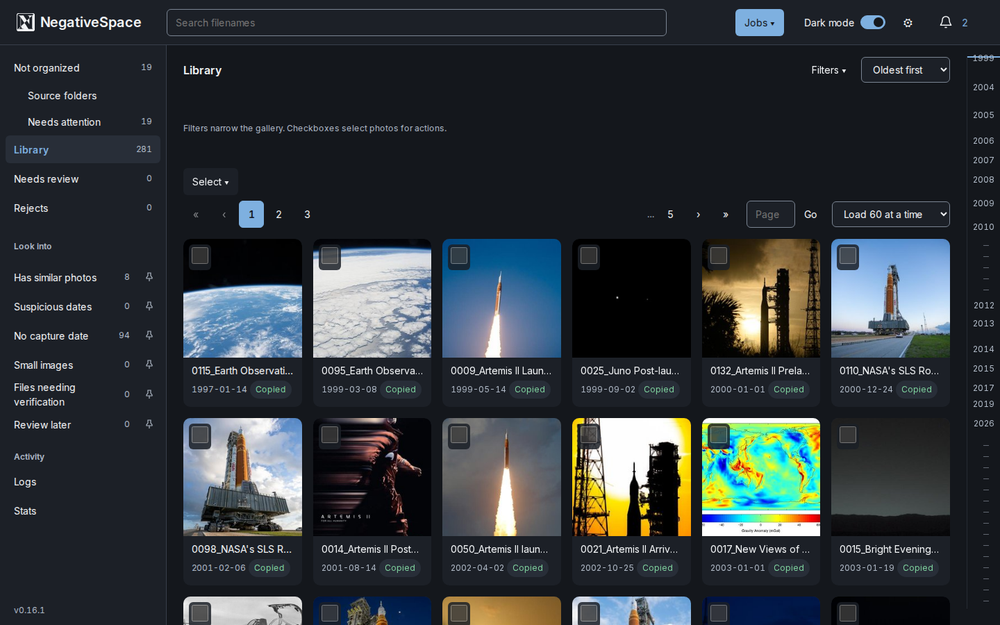

# NegativeSpace

NegativeSpace puts a large, messy photo collection in order. It reads each photo's date
and files it under `YYYY/MM/DD`, files exact duplicates once, finds look-alikes, and
lets you set aside the photos you don't want. It runs in Docker on your own machine, and
you use it from a browser.

**Your originals stay safe.** NegativeSpace can run without ever changing your photos:
mount your source read-only and use Copy. Every photo is verified in its new place
before Move deletes an original, and rejected photos are set aside, never deleted.
[How your photos are protected](docs/user-guide.md#how-your-photos-are-protected)
explains each safeguard.

> **NegativeSpace is not a backup.** It backs up its own catalog, never your photos. Keep
> your own backups of your photos. See [If something goes wrong](docs/recovery.md).



## Install

You need Docker with the Compose plugin, and a desktop browser. Everything else is inside
the images, which you build from this repository.

NegativeSpace is tested on Linux. On Mac or Windows,
[Rancher Desktop](https://rancherdesktop.io/) (free and open source, with its container
engine set to dockerd) may work, but it is untested.

```bash
git clone https://github.com/MatthewJSalerno/NegativeSpace.git
cd NegativeSpace/docker
cp .env.example .env          # set the four folders below, and PUID/PGID
docker compose up -d --build
```

Open **http://localhost:8080**. `docker compose down` stops it.

## Folders

Set four folders on the host in `docker/.env`:

| Variable | Holds | Access |
| --- | --- | --- |
| `SOURCE_DIR` | Your photos, as they are | Read-only. Make it writable only if you want to Move |
| `DEST_DIR` | The organized photos (`library/`) and the ones you reject (`rejects/`) | Read-write |
| `APPDATA_DIR` | The catalog: every photo's details and history | Read-write |
| `BACKUP_DIR` | Automatic catalog backups (no photos) | Read-write |

- Keep source and destination separate, with neither inside the other. The same goes for
  app data and backups; put backups on different storage if you can.
- `library/` is laid out by date for your gallery app of choice, such as Immich, to
  read. `rejects/` sits beside it, so photos you turn down stay out of your gallery.
- Set `PUID` and `PGID` to your own user (`id -u`, `id -g`) so the files it writes belong
  to you, and `TZ` to your time zone (for example `America/New_York`).

[Installation details](docs/install.md) covers each folder, network shares, reverse
proxies, writing your own compose file, and stopping a job.

## Getting started

1. **Create the catalog.** The first visit offers **Create new catalog**, then five short
   setup steps. You can change any of them later in **Settings**.
2. **Index.** **Index source** reads every photo's date and content. Nothing is copied or
   moved.
3. **Copy or Move.** **Copy all photos…** files them into `library/` and leaves your
   source alone. **Move all photos…** also deletes each original once its copy is
   verified. You can also do one folder at a time from **Source folders**, or only the
   photos you select.
4. **Review.** **Has similar photos** finds look-alikes to compare. **Needs review** lists
   photos waiting for a decision, such as small images. **Reject…** sets a photo aside in
   **Rejects**, and **Return to library** brings it back.
5. **Check.** **Logs** lists every job and failure, with **Retry**. Each photo's history
   shows everything that happened to it.

The [user guide](docs/user-guide.md) walks through each step with screenshots.

## Before you open it to other machines

**There is no sign-in yet.** Anyone who can open the page can use every button, including
**Move**. A single password is planned before the first release. Until then:

- Keep it on your own network, and never forward port 8080 to the internet.
- From elsewhere, use a VPN (such as WireGuard or Tailscale) or a reverse proxy that asks
  for a password first.
- To open it by a hostname or LAN address, add that address in **Settings › Access** or to
  `NS_ALLOWED_HOSTS` in `docker/.env`. Other addresses are refused.

[Network access](docs/install.md#network-access) has the details.

## What it doesn't do

It never backs up your photos, edits pixels, or manages albums, people or faces (that is
what gallery apps such as Immich are for). It is for one person, not several accounts.
**Not yet:** videos, editing metadata other than the date taken and rotation, phones and
tablets, and Mac or Windows hosts. The
[full list](docs/webui-spec.md#8-explicitly-out-of-scope) gives the reasons.

## Documentation

| For | Document |
| --- | --- |
| Using it | [User guide](docs/user-guide.md) · [Installation details](docs/install.md) · [If something goes wrong](docs/recovery.md) |
| What changed | [CHANGELOG.md](CHANGELOG.md) |
| Developing it | [project-spec.md](docs/project-spec.md) (start here) · [webui-spec.md](docs/webui-spec.md) · [engine-spec.md](docs/engine-spec.md) · [api-spec.md](docs/api-spec.md) · [ui-design.md](docs/ui-design.md) · [user-docs-standard.md](docs/user-docs-standard.md) · [engine-cli.md](docs/engine-cli.md) · [tests/README.md](tests/README.md) · [TODO.md](TODO.md) |

## License

NegativeSpace is free software under the
[GNU General Public License, version 3 or later](LICENSE), with no warranty.
