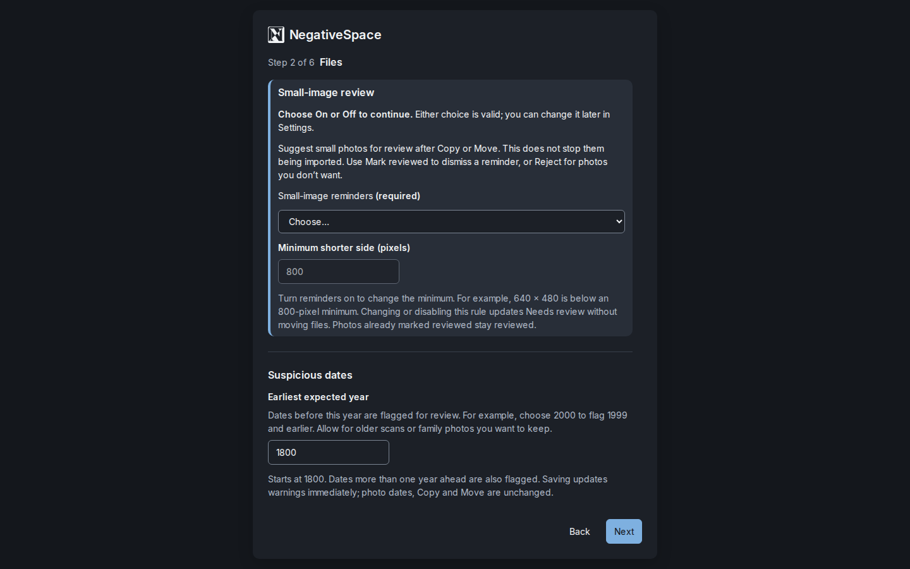
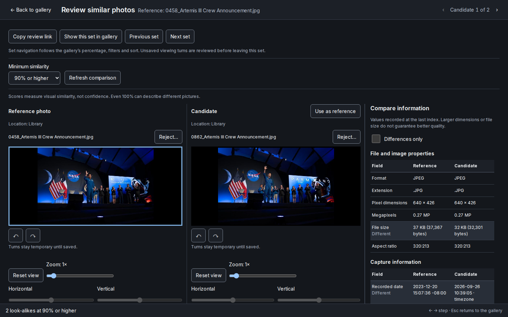

# User guide

A first session with NegativeSpace, start to finish. The screenshots use NASA's public
image library.

Install it first: the [README](../README.md#install) takes four commands.

## How your photos are protected

NegativeSpace is designed to be careful with your files.

**You can run it without it ever changing your originals.** Mount your source folder
read-only, which is the default in the included compose file, and use Copy. NegativeSpace
reads your photos and builds an organized library from them in a separate folder. Your
originals stay exactly as they were, and you can check the library your own way before
deciding what to do with them. Move, which deletes originals once they are safely in
your library, only works if you make the source writable yourself.

- **Every photo is verified in its new place.** After writing a photo into your library,
  NegativeSpace reads it back and confirms it is identical to the original. Move deletes
  the original only after that check passes.
- **Existing files are not replaced.** If a name is already taken in your library, the
  new photo gets a numbered name.
- **Rejected photos are set aside, not deleted.** They go to a Rejects folder, and you
  decide when to empty it.
- **You see what will happen first.** Copy, Move and Reject each show what they will do
  and ask before they start.
- **Interrupted jobs are finished safely.** If a job is stopped partway, the next start
  checks what it left unfinished before doing anything else.
- **Its records are backed up.** After each job that changes something, it saves a
  backup of its catalog to a separate folder.

**It runs with ordinary permissions.** Neither container needs privileged mode or extra
permissions. The part that reads and writes your photos runs as your own user (the
`PUID`/`PGID` you set), so every file it creates belongs to you. The web container that
serves the pages has no access to your photo folders at all.

After a job finishes its file work, **Backing up catalog…** appears until its backup
finishes. You can browse during this step; photo-changing actions become available
afterward. Nothing is queued to start automatically.

If a backup fails, the notice below the top navigation explains what needs attention.
Fix the reported problem, then choose **Retry backup**. This backs up the catalog
without repeating the file work. **Back up now** also appears if changes were left
without a backup after an interruption. Open **Details** for the last backup time and
technical information.

**NegativeSpace is not a backup of your photos.** It backs up its catalog, never the
photos themselves. Keep your own backups. See [If something goes wrong](recovery.md).

## 1. First start

Open **http://localhost:8080**. There is no catalog yet, so the page offers to create one,
then walks through the settings in six steps. They are starting values, and every
one can be changed later from the gear icon at the top right.

The **Appearance** step sets the palette and light/dark preference. **Files** chooses
file types, the earliest expected photo year, and when to be reminded to empty Rejects.
It also requires a choice to enable or disable small-image reminders; these never
restrict Copy or Move. Expand **File types** or **Rejects reminder** to adjust those
settings; they start collapsed to keep this step shorter. **Metadata** explains which source supplies metadata and asks how to
handle shared XMP sidecars and where to save edits. **Backups** explains catalog backups, **Performance** sets how
many photos are read at once, and **Access** saves additional addresses used to open the app.

## 2. Index: read your photos

The library starts empty. **Jobs** holds the jobs for the whole library; each item says
what it does, and why when it cannot run yet.

**Index** reads every photo in your source: its date, a checksum of its content, and a
small thumbnail. It moves and copies nothing, and never writes to your source. Its progress
shows at the top of the page; closing the browser does not stop it.

## 3. Look around

When Index finishes, **Not organized** shows the source photos and an Index summary.
Select a summary count to see those photos. **Additional identical copies** shows the
photos that have them, so there may be fewer cards than extra files. **By file type**
shows what Index found, including photo types turned off in Settings and files left
in the source. You can find the same breakdown in that Index's entry in **Logs**.
Copy and Move confirmations count ready photos separately from files that need attention.
**Library**, **Similar photos** and **Rejects** remain empty until photos are organized.
The places are in the sidebar on the left. Choose **Similar photos** to compare Library
photos. Buttons above the photos narrow the view; choose more than one to combine them.
**Needs review** adds a **Reason** selector. Warning notes in the sidebar open the whole
affected list. Choosing a place clears search and filters; your browser’s Back button
restores the previous view.

**Filters** beside the sort narrows by type, date or image size. Size browsing includes
photos you have marked reviewed and works even with reminders off. It does not change
reminder settings. The box at the top searches filenames; the years on the right jump
through photos sorted by date: point to see the month, click to go.
**Source folders**, under Not organized, lists the source's folders and when each was last
indexed. Open one folder to index, copy or move just that folder; **Index this folder**
reads it again after you add photos to it, without reading the whole source. With **Still
in source**, find the originals of photos you have already copied and move them off the
source.

When different photos in your results have the same name, their cards show the shortest
part of the original source folder that tells them apart. Hover over a photo’s name to
see its original path and any identical copies’ paths. A name changed on arrival also
explains that another photo already had that name.

Click a photo to open it in the panel on the right: its file, its dates and where they came
from, and its history.

## 4. Copy or Move

**Jobs › Copy** files every photo not yet organized into the destination's `library/`
folder, under `YYYY/MM/DD`, and never touches your source. **Move** does the same, then
removes each original once its copy is verified (it needs a writable source). Either can
take everything or one folder from Jobs. Tick photos instead and the bar at the top
offers what applies to them: Copy, Move, Reject, or Return to library. Each asks first.
A selection holds library photos or photos in Rejects, never both, so each action means
one thing. When a job finishes, you are where you were, and the bell at the top right
lists it under **Notifications**: **Show these photos** shows what it did, and you can
search and filter them like any other photos.

Which to use is your choice. If you would rather not give any app write access to your
originals, use Copy only: the source stays read-only, you check the library your own way,
and you delete the originals yourself once you are confident. NegativeSpace never needs
to delete anything for its library to be complete.

## 5. Similar photos

**Similar photos** lists organized Library photos with look-alikes; unorganized
source files are not compared in this view. Open one and choose **Similar
photos**: the counts show how many matches it has at each percentage. The percentage
measures visual similarity, not certainty; below 90%, matches are more likely to be
unrelated. Mostly dark or plain photos carry a note because even a high percentage
can pair unrelated scenes. You can still compare every match. **Stats › Catalog health**
shows how many of your photos have little detail.

Open a match to compare the two side by side: their size, format, dates and every
recorded detail. **Reject…** under a photo turns that one down; **Keep this one, reject
the other…** keeps one and reviews the rest before anything moves.

Turns stay temporary until you save them. Leaving one turned photo offers **Save and
continue**, **Discard and continue**, or **Keep reviewing**. Saving must finish before
you leave; a failure keeps the photo open. With several turned photos, choose which
rotations to save. Use the curved-arrow buttons beside
the large preview to turn it left or right,
then **Save rotation** to keep the change or **Reset** to undo the viewing turn.
For several selected photos, **Rotate…** in the selection bar opens a confirmation.
Only checked photos turn, reset or save; unchecked photos stay as they are.
It saves Orientation to the photo’s metadata source without changing image pixels or your source files. A turn
saved in an XMP sidecar needs a gallery that reads sidecar Orientation.

To change a Library filename, open **Photo information** and choose **Rename…** beside
the destination filename. **Also arrived as** lists recorded alternative names;
**Use this name** opens the same preview. The extension and date folder stay unchanged,
and any active XMP sidecar follows the photo. Check the resulting name, then confirm
**Rename photo**. A taken name gets a numbered suffix; source originals stay untouched. **Filters › Has
other names** finds photos with naming alternatives, most duplicates first.

## 6. Reject what you do not want

**Reject…** moves a photo out of your library into a separate `rejects/` folder in your
destination. Nothing is deleted: the **Rejects** view shows what it holds, **Return to
library** brings a photo back, and you empty the folder yourself (**How to empty
Rejects** says how). A reminder appears on every page once Rejects grows past a size or
age you set in Settings.

For several photos, review the selection, choose **Reject these n photos**, then confirm
**Reject**. **Cancel** keeps your selection so you can adjust it. The same question
appears for one photo; only side-by-side comparison offers **Don't ask again while
comparing**. Rejecting its last Library photo always asks again.

If you Move, a rejected photo's original in your source is deleted too, once its copy in
Rejects is verified, so the source can end up empty. That copy is then the only one:
empty Rejects and the photo is gone. Every Move that includes rejected photos says so first.

## 7. Check dates

**Odd dates** flags recorded years earlier than the minimum you chose in setup
(default 1800), or more than one year ahead of the current UTC year. Change the minimum
in **Settings › Files** to suit your collection. These are clues to investigate, not proof
of a wrong date; NegativeSpace changes no date by itself.

In **Library › Needs review**, choose **Reason › Suspicious dates** and **Inspect photo**.
If the date is right, choose **This date is correct**. If it is wrong, choose **Edit date…**
and save the date you want. Either answer clears the date reminder; other reminders and
Bookmarks stay. A date you confirm can still appear under **Odd dates**, which shows all
dates outside your expected range. Changing Settings does not undo your confirmation.
The date confirmation warns when your chosen year looks unusual; you can still save
it if it is correct. **View job details** shows the metadata source you edited and
its date before and after that edit, even if you change the date again later.

**Review history** records your answers and explains when a date or size reminder clears
because its recorded facts or your settings changed.

**No date** lists photos with no usable date in their metadata. A missing date alone does not prevent **Copy** or **Move**. A photo can also appear under **Not organized › need attention** if a separate issue prevents organizing it; open its information pane for the specific reason. They are filed
under `library/Undated/<year>/`, where the year comes from the file's modification time,
rather than among photos the camera dated. A file's time is often when it was downloaded
or exported, not when the photo was taken. Filing it with camera-dated photos would make
a guess look like a fact. In a real library, roughly 8% of photos have no usable date.
The photo's original path and filename are kept with it, and they often hold the real
date.

**Small images.** If you turned on small-image reminders in setup, photos whose shorter
side is below your minimum appear in **Library › Needs review › Small**, with their size.
They are still copied and moved like any other photo. **Mark reviewed** stops the
reminder for a photo you want to keep; select the ones you don't want and use
**Reject…**. A larger look-alike is a hint, not an automatic choice. Change or turn off
the small-image rule in **Settings › Files**.

**Bookmark…** lets you choose why you want to return to a photo and add a short note.
Find these photos through **Library › Needs review**, then **Reason › Bookmarked**.
**Remove bookmark** clears the bookmark; editing a photo does not clear it automatically.
For a keep-decision bookmark, **Keep it** records your decision and removes that bookmark.
Other review reasons remain unchanged. **Review one by one** steps through them;
**Next** moves on without deciding.

In a Library photo’s **Metadata** tab, open another recorded source and choose
**Use as primary…** to make it take priority for that photo. Review the metadata and
folder changes before confirming. Future edits use that source; your other recorded
sources remain available. **Copy date to primary…** copies only the date and keeps
your current primary source.

## 8. History, logs and stats

Every photo keeps its full history: each file it has been, each copy made of it, and
every job that touched it. **View lineage tree** opens a timeline with a summary,
then the jobs in order and the files they worked on. Identical files found together
share an Index entry; files found later have their own entries. **Show all** reveals
additional paths, and **Show events** expands repeated steps in a long history.
Later edits don't change which files matched when they arrived. If an edit makes
two files identical, the timeline shows their separate arrivals and the edit that
joined their histories.
**View in log** opens the related job. **Now** shows the last recorded locations,
not a live check of your files. Hover or focus a path for its recorded details.

**Logs** lists every job and everything it did, with any failures, their reasons, and
**Retry**. Expand **Metadata choices** to see saved import decisions and the jobs that
applied them. The same section appears in the photo’s lineage; **Compare metadata…**
compares a saved choice with the photo’s current primary source without changing it.

**Stats**, under Logs in the sidebar, gives figures for the whole library.

## 9. Settings

The gear icon opens Settings, in six tabs: **Appearance**, **Files**, **Metadata**, **Backups** (with
the list of catalog backups and Back up now) **Performance**, and **Access**. Access saves the additional hostnames/IP addresses
you use to open the app. These settings survive replacing the photo catalog. Local
and Docker-configured addresses remain available for recovery.

**Performance** sets how many photos are read at once, and manages the thumbnail cache:
**Free up previews** removes the large previews made when you open a photo, which are made again
the next time you open it, and **Repair grid thumbnails** remakes any gallery thumbnails
that have gone missing. **Rebuild all grid thumbnails** remakes every one.

**Metadata** keeps the same choices you made during setup. Changing its defaults does
not change photos that already have a primary metadata source.

## Next

- Keep your own backups of your photos and of the destination.
- Point a gallery application such as Immich at the destination's `library/` folder, not
  the destination itself.
- [If something goes wrong](recovery.md) explains what can be recovered, and how.
